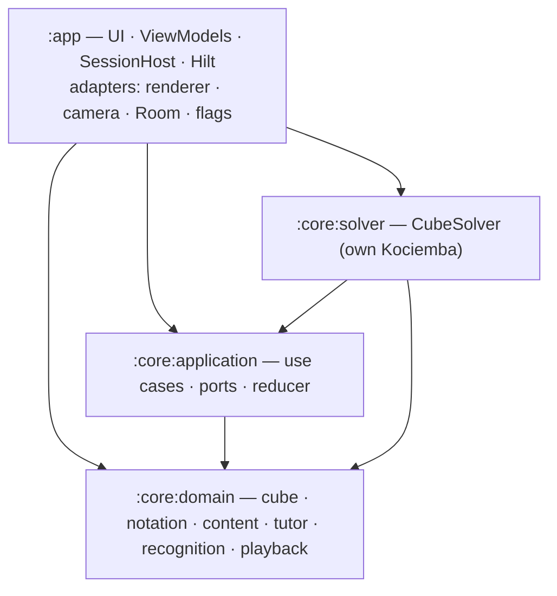
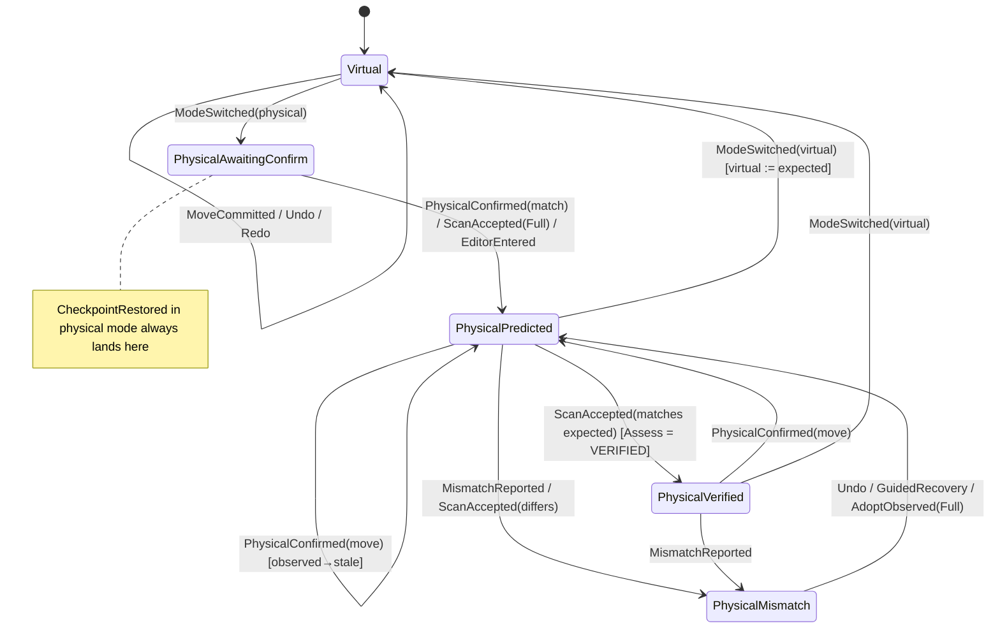
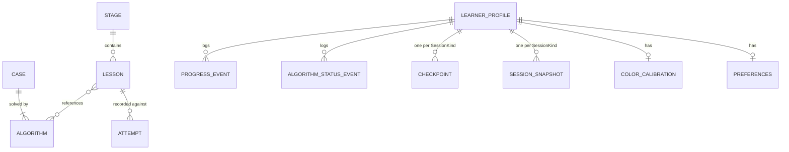
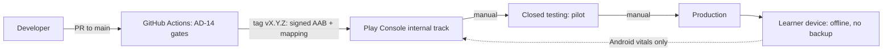

# Architecture Spine — RubikXplorer

## Design Paradigm

**Hexagonal (ports & adapters)** with a **functional core / imperative shell**:
- The domain is pure, immutable value transformations.
- The application layer owns the session state and declares the ports.
- Adapters do all I/O.
- Gradle module boundaries enforce the dependency direction.

| Layer | Module | Holds | Android deps |
| --- | --- | --- | --- |
| Domain (functional core) | `:core:domain` | cube model, Notation, `CubeValidator`, content model, predicates, tutor rules (`Assess`, `CandidateEnumerator`), `LastLayerMatcher`, recognition classification and assembly, `PlaybackController`, `MoveNote`, `StickerAppearance` | none |
| Solver adapter | `:core:solver` | clean-room Kotlin Kociemba two-phase implementation of `CubeSolver` | none |
| Application | `:core:application` | use cases, ports, `LearningSession` reducer, transition table | none |
| Shell | `:app` | Compose UI, ViewModels, `SessionHost`, Hilt, adapters (renderer, gesture interpreter host, CameraX, Room, feature flags) | yes |



## Invariants & Rules

### AD-1 — Module dependency direction [ADOPTED]

- **Binds:** all
- **Prevents:** Android or framework types leaking into business logic; adapters calling each other sideways.
- **Rule:**
  - Dependencies follow the diagram above and nothing else.
  - `:core:*` are `kotlin("jvm")` modules with no Android, Compose, Room, CameraX or Hilt dependency.
  - `:core:application` declares every port.
  - Adapters live in `:app` or (for `CubeSolver`) `:core:solver`. Only `:app` wires them.

### AD-2 — Cube State: cubies + orientation, one home frame, one sticker layout

- **Binds:** FR-1, FR-2, FR-10, FR-14, FR-15, FR-18, FR-21–FR-28, NFR-4
- **Prevents:** renderer, editor, scanner, predicates and Solver disagreeing on piece identity, held orientation or sticker indexing.
- **Rule:**
  - **State:** `CubeState = (cubies, orientation)`.
    - `cubies` holds corner and edge permutation and orientation, relative to the centers.
    - `orientation` is one of the 24 whole-cube rotations. It maps the Learner-facing faces U R F D L B to center colors.
  - **Moves:**
    - A face Move is applied *through* `orientation`.
    - A Cube Rotation (x, y, z) changes only `orientation`.
    - Slice and wide Moves are applied as their face-turn equivalent plus a rotation.
  - **Equality and solved status:**
    - `isSolved` and every predicate ignore `orientation`.
    - Sync comparison checks `cubies` and `orientation` separately. A difference in orientation alone is the Error Category `UNEXPECTED_ORIENTATION`.
  - **Home frame:** in the solved home state, WHITE is on U and GREEN is on F (so RED is on R). Content entry states, Scrambles and fixtures are expressed from home.
  - **`Facelets`:** a `List<Color>` of 54 entries in URFDLB face order. Within each face, indices 1–9 run row-major as in the Kociemba net:
    - U: B edge at the top.
    - D: F edge at the top.
    - F, R, B, L: U edge at the top.

    A diagram fixture of this layout is checked in.
  - **Validation gate:** `CubeValidator.validate(Facelets): ValidationResult` in `:core:domain` is the only route from `Facelets` to a `CubeState`.

### AD-3 — One state owner per flow: `LearningSession`, revisioned

- **Binds:** FR-1–FR-13, FR-16, FR-17, FR-19, FR-20, FR-26, FR-27, NFR-1, NFR-4, NFR-6
- **Prevents:** drift between engine, rendering and Expected State; two event loops over one flow; stale async results applied to a newer state.
- **Rule:**
  - **Sessions:**
    - Every `LearningSession` has a `SessionKind`: `LESSON`, `PRACTICE`, `TWO_LOOK` or `SOLVE_PLAYBACK`.
    - At most one session is active app-wide. It is held by an `@Singleton SessionHost` in `:app`, never by a ViewModel.
    - Starting a session of another kind first suspends the current one.
  - **Not sessions (AD-20):** the Library, Demonstrations, the free cube, the Manual Cube Editor and Scan review.
  - **Reducer:**
    - Every change is a `SessionEvent`, applied by the pure `reduce(SessionState, SessionEvent): Transition(state, effects, presentation)`.
    - Events are serialized on one confined loop. Each event is stamped with `at: Instant` at dispatch, and the reducer never reads `Clock` or `RandomSource`.
    - `reduce()` does only bounded work: predicates, rule tables, and candidate enumeration up to the configured `maxDepth`. Any search (Solver, `RecoveryPlanner`) runs as an Effect with a timeout.
  - **Revisions:**
    - `SessionState.revision` increases monotonically.
    - Every async Effect carries an `effectId` and the `revision` it was issued at, and its result event echoes both.
    - The reducer applies a result only when its `revision` is current. Otherwise it records `EffectResultDiscarded` and re-offers the action if the user started it.
    - Any event that changes `virtual` or `expected` cancels the effects that depend on them.
  - **Transitions:** the normative transition table (`session/TRANSITIONS.md`) and the Sync State Machine below define, for each event and mode:
    - which of `virtual`, `expected` and `observed` the event mutates;
    - whether it can be undone;
    - whether it clears redo.

    The minimum rules are:
    - In physical mode, `virtual` mirrors `expected`.
    - Undoing a `PhysicalConfirmed` reverts `expected` and asks the Learner to perform the inverse.
    - `ScanAccepted`, `ModeSwitched` and `CheckpointRestored` are undo barriers and clear redo.
    - Any `PhysicalConfirmed` marks a prior `observed` as stale.
  - **Teaching Mode:** `teachingMode` is a field of `SessionState`. Predicate evaluation never depends on it. When to reveal the next Move is decided by `TutorDecision.reveal`, never by a screen.



### AD-4 — Commit before animate; the renderer is a projection

- **Binds:** FR-1, FR-2, FR-3, FR-6, FR-16, FR-18, NFR-1, NFR-2, NFR-4, NFR-7
- **Prevents:** half-applied Moves; the rendered cube differing from logical state; buttons and gestures taking different paths.
- **Rule:**
  - **Commit first:** every input source (gesture, button, accessibility action) produces a `MoveIntent`. The ViewModel maps every `MoveIntent` to the same `MoveCommitted` event: a `SessionEvent` in a Learning Session, or a `FreeCubeEvent` reduced by the pure free-cube reducer on the free cube, which stays outside the session model (AD-3, AD-20). Input during an animation is committed immediately.
  - **Presentation:** each `Transition.presentation` is a list of `Animate(move)` or `Snap` items, each carrying its target `revision` and `CubeState`.
    - Undo produces `Animate(inverse)`.
    - Restores and scans produce `Snap`.
    - When more than 3 items are queued, the queue fast-forwards at increased speed. It never drops a committed Move.
  - **Renderer contract:** `CubeRenderer` receives a `CubeState`, the presentation queue and a `RenderStyle` (color-blind display, speed). It never mutates state.
  - **Test hook:** the renderer exposes `renderedFacelets()` for tests, and must end exactly at the last target state.
  - **Gestures:** gesture interpretation is a pure `GestureInterpreter` (touch path + view pose → `MoveIntent?`). Below the confidence threshold it returns no intent.
  - **View Rotation:** stays local to the renderer and never becomes a `SessionEvent`.
  - **First adapter:** a 2D net renderer is the first `CubeRenderer` (P0.1). The 3D adapter replaces it behind the same port.

### AD-5 — Observations and Certainty

- **Binds:** FR-7–FR-12, FR-16, FR-26, FR-28, PRD Principle 3
- **Prevents:** a predicted cube treated as observed; partial scans "completed" from the Expected State; different screens reporting different Certainty for the same evidence.
- **Rule:**
  - **Fields:** `SessionState` holds `virtual`, `expected` and `observed: PhysicalObservation?`.
  - **Observation types:** `PhysicalObservation` is one of:
    - `Full(state)`, which can be produced only through `CubeValidator`;
    - `Partial(faces: Map<Face, List<Color>>, pose)`, which is checked for internal consistency only, is never completed from `expected` and never becomes a `CubeState`.

    A `Partial` can be adopted (`AdoptObserved`) only after it is completed to `Full` by a Guided 6-face Scan or the Manual Cube Editor.
  - **Who produces Certainty:** only `tutor/Assess` in `:core:domain`, for both confirmations and Diagnoses.
    - It uses one `CandidateEnumerator(expected, maxDepth, moveSet)`, with `maxDepth` and `moveSet` taken from tutor configuration data.
    - `VERIFIED` requires both of:
      - the observed faces cover every face that any Move since the last `Full` VERIFIED observation could have touched;
      - exactly one candidate is consistent.
    - Otherwise the result is `LIKELY` or `UNKNOWN`.
    - `Diagnosis.verified(...)` is a smart constructor that requires a unique match.
  - **Categorical only:** `Certainty` is `{VERIFIED, LIKELY, UNKNOWN}` and `StickerConfidence` is `{CONFIDENT, UNCERTAIN}`. No numeric confidence crosses a module boundary.
  - **Error Categories:** `ErrorCategory` is a closed enum: `WRONG_MOVE_OR_DIRECTION`, `WRONG_PIECE`, `WRONG_PIECE_ORIENTATION`, `UNEXPECTED_ORIENTATION`, `COMPLETED_LAYER_DISTURBED`, `INVALID_ENTERED_STATE`, `UNKNOWN_DISCREPANCY`.
    - Every category maps to exactly one Recovery Path.
    - `when` over it must be exhaustive.
    - There is one test per category.
  - **TutorDecision:** has exactly these fields: `objectiveId`, `satisfied`, `diagnosis?`, `certainty`, `nextAction`, `explanation: Text`, `recovery: Pending(effectId) | Ready(moves) | Unavailable`, `reveal`, `advance`, `feedback: MoveFeedback?`.
  - **Test me feedback:** `MoveFeedback` is a closed enum, `ON_PATH | PROGRESS | NEUTRAL | HARMFUL`. Only `Assess.classify(lesson, entry, before, move, after)` produces it.
    - **When:** it is computed only on `MoveCommitted` in *Test me*, and every other event clears it.
    - **Against what:** it judges the Move against the step derived from `before` (AD-6), never against whole-Objective progress. It checks the outcomes in this order:
      - `ON_PATH`: `before` is an authored path state and `move` is the next authored Move, compared as canonical Moves (AD-7). Either quarter turn of an authored half turn in its direction also counts. This is a state match, never a stored move counter.
      - `HARMFUL`: the Move disturbs a piece the step preserves. It produces a Diagnosis.
      - `PROGRESS`: the step's effective `done` progress rises.
      - `NEUTRAL`: any other case, including a progress drop that disturbs no preserved piece.
    - **On path wins:** while the state is on the authored path, Assess emits no disturbance Diagnosis (`COMPLETED_LAYER_DISTURBED`). This covers the taught Moves that lift a solved piece for a moment.
    - **Physical mode:** a Harmful Diagnosis is `VERIFIED` only on the virtual cube or after a verified observation; on a predicted state it is at most `LIKELY`. While awaiting confirmation or after a mismatch, there is no feedback.
  - **Information-request order** (FR-9): Quick Check → which Move → one face → full re-entry.

### AD-6 — Content is data: schema, predicates, IDs, text

- **Binds:** FR-4–FR-6, FR-12, FR-13, FR-17, FR-18, FR-20, FR-27, NFR-10
- **Prevents:** Lesson logic forked into screens; incompatible content shapes; predicates anchored to the wrong face; key collisions; duplicated Algorithms.
- **Rule:**
  - **Storage:** Stages, Lessons, Algorithms, tutor configuration and Mastery Conditions are JSON under `:core:domain` resources, parsed by kotlinx.serialization.
    - `content/schema/*.schema.json` is the single shape source, and a test checks it against the Kotlin model.
    - Every bundle carries a `schemaVersion` and a `contentRevision` (a hash of the bundle).
  - **Lesson shape:** `{ id, stageId, prerequisites[], objective: TextKey, entryState, demonstration: MoveSeq, learnerAction, completion: Predicate, preserve: Predicate, recovery: RecoveryRef, steps[]: { goal, done: Predicate, preserve, watch, notice: TextKey, moves } }`. Every field is required.
  - **Steps:**
    - **Effective done:** a step's effective `done` is `allOf(lesson.preserve, done)`. The last step's `done` equals `completion`, and the content test checks that they are structurally equal. So when every `done` holds, the Lesson is complete; only `completion` decides that.
    - **Current step:** it is a pure function `Tutor.currentStep(lesson, entry, state)`. It is never stored in `SessionState`, a Checkpoint or a Snapshot.
      - On the authored path (an exact `CubeState` match with a path state), it is the step whose Moves lead to the next path state. After the final Move it is the last step.
      - Off the path, it is the first step whose effective `done` is unmet.
      - So steps done out of order and Undo across a step boundary re-derive it. Per-step UI state (`revealRequested`) resets whenever the derived step changes.
      - In *Show me*, the step card follows the Demonstration's playback position (AD-20).
    - **Preserved pieces:** a step's preserved pieces are derived, never authored. They are the `preservedPieces` of the Lesson's `preserve`, plus those of every other step whose effective `done` holds before the Move. `steps[].preserve` is the Keep card text only.
    - **Content test:** along the authored path, step k's `done` is false at every state before step k's last Move. It holds at the end of step k and at every later step boundary; it may lapse mid-step, as when F' in step 4 of `lesson-03-04` lifts step 1's corner. A step `done` that the registry cannot express uses `state-reached` or a new color-anchored predicate added in Story 4.1.
  - **Predicates:**
    - `Predicate` is a `@Serializable` sealed hierarchy with discriminator `"predicate"` and flat parameters. The registry provides the only combinators, `allOf` and `anyOf`.
    - Predicates are **color-anchored** (they find faces by center color) and orientation-invariant.
    - Each predicate implements `preservedPieces(state)`. `RecoveryPlanner` and `COMPLETED_LAYER_DISTURBED` use it.
    - Each predicate implements a pure `ObjectiveProgress` measure, shared by *Test me*, Diagnosis and recovery.
    - An unknown predicate fails the content test.
  - **IDs:**
    - Stage, Lesson, Case (`case-oll-45`) and Algorithm (`alg-oll-45-a`, which declares its `caseId`) IDs are distinct, stable namespaces. An ID is never reused once shipped.
    - 2-look Lessons reference Algorithm IDs and never copy Notation.
  - **Text:**
    - All Learner-facing text, including domain messages (`msg.*`), is a `Text(key, args)`. The key has the form `<area>.<contentId>.<field>[.<n>]` and uses ICU named arguments.
    - The text lives in `content/strings/<locale>.json`. `strings.xml` holds static navigation chrome only.
    - The content test fails on duplicate, missing or argument-mismatched keys.
  - **Derived data:** Case states and recognition diagrams are derived (AD-19), never stored.

### AD-7 — Notation: one parser, canonical Moves

- **Binds:** FR-1, FR-5, FR-6, FR-16, FR-18, FR-26
- **Prevents:** modules parsing or comparing `R2'`, `r` and `M` differently.
- **Rule:**
  - `Notation.parse` and `Notation.format` in `:core:domain` are the only conversions between strings and Moves. Modules exchange `Move` values.
  - Move equality is by effect (`R2 == R2'`). `format` emits the canonical form.
  - Slice directions follow WCA: `M` turns like `L`, `E` like `D`, `S` like `F`.

### AD-8 — The Solver finds paths; it never teaches

- **Binds:** FR-12, FR-15, FR-16, FR-25, NFR-3, NFR-11
- **Prevents:** tutor behavior depending on Kociemba output; licence contamination; the Solver blocking UI or Lessons.
- **Rule:**
  - **Implementation:** `CubeSolver` is a **clean-room Kotlin implementation** of Kociemba's two-phase algorithm, written from the published description. No third-party solver code is copied.
  - **Callers:** only the `SolveCube` and `PlanRecovery` use cases call it, always as an Effect with a timeout of 3 s.
    - Diagnosis, predicates and Placement never call it.
    - It receives `cubies` only and returns Moves relative to the centers. `SolveCube` maps them back through `orientation`.
  - **Results:** returns `SolveResult.{Solved, Invalid, TimedOut, Failed}`. Every `Solved` result is re-verified by applying it to its input before it is shown.
  - **Pruning tables:** built off the main thread and cached in app-private storage. Lessons never wait on them.

### AD-9 — Recognition: neutral samples in, validated observations out

- **Binds:** FR-21–FR-28, NFR-5, NFR-8, NFR-11, NFR-12
- **Prevents:** pixel code spreading across features; camera types reaching the domain; unvalidated or partial scans reaching the Solver; two owners of Color Calibration.
- **Rule:**
  - **Camera adapter:**
    - Only the CameraX adapter in `:app` touches pixels.
    - It emits `FaceSample`s: `centerColor`, `upNeighborColor` and 9 CIELAB samples **in viewfinder order**, plus quality flags and the capture pose.
    - Quick Scan's detection and perspective correction live inside the adapter and emit the same type.
  - **Assembly and classification:**
    - Only `ScanAssembler` in `:core:domain` rotates samples into `Facelets` order.
    - `StickerClassifier` receives the calibration as a parameter.
    - The result is `ScanResult` = `Full(Facelets + confidence)` or `Partial(...)`.
  - **Acceptance:** the reducer rejects `ScanAccepted` unless:
    - a `Full` result is valid;
    - every `UNCERTAIN` sticker has been corrected or confirmed by the Learner;
    - `basedOnRevision` is current.
  - **Scan flow:** a sub-flow that returns `ScanOutcome {Accepted, Cancelled, FellBackToEditor}` to its caller through a typed navigation result. Only the caller dispatches it. The scan flow never touches a session.
  - **Color Calibration:** owned by `CalibrationRepository`, and written only by the `UpdateCalibration` and `ResetCalibration` use cases. It is never stored in `SessionState` or a Checkpoint.
  - **Frames:** never persisted or sent anywhere. A **debug-only** fixture recorder exports `FaceSample` JSON with ground truth. Release builds don't contain it.

### AD-10 — Persistence: snapshots, checkpoints and append-only logs

- **Binds:** FR-12, FR-17, FR-19, FR-20, FR-27, NFR-6
- **Prevents:** lost resume points; checkpoint races; duplicate Attempts; stale content restored by index; two owners of status data.
- **Rule:**
  - **Two saves, two purposes:**
    - A `SessionSnapshot` is written on every committed transition, for process death.
    - A `Checkpoint` is written at Objective boundaries and survives disturbances (FR-12).
    - Both are keyed by `SessionKind`. Only `LESSON`, `PRACTICE` and `TWO_LOOK` resume on cold start.
  - **Checkpoint format:** a versioned DTO (`checkpointFormat`, `contentRevision`, content **IDs**, `Facelets` + orientation strings, history as Notation, mode). It is never the raw `SessionState` and never embeds content.
    - Restore resolves the IDs against the loaded content. On a revision mismatch or a missing ID, it falls back to the start of the Lesson with the stored cube, and tells the Learner.
    - A restored physical session always lands in `PhysicalAwaitingConfirm`, with `observed` cleared and no effects resumed.
    - Every format bump ships with a decoder for the previous format and a round-trip test.
  - **Writes:**
    - All writes go through one serial writer.
    - Snapshot writes are conditional on `revision`.
    - When one transition produces log rows and a snapshot, they are written in one transaction.
    - Log rows carry an idempotency key `(sessionId, revision)`.
  - **Append-only logs:**
    - `attempt` is written only from the reducer's `AttemptStarted` / `AttemptEnded(objectiveId, outcome, errors, hints, assistanceLevel)` effects.
    - `progress_event` has the types `LessonCompleted`, `StageSkippedByCheck`, `StageSkippedByPlacement`, `StageUnlocked` and `ProgressReset(epoch)`. Stage status and Mastery are pure functions over the current epoch.
    - `algorithm_status_event` is keyed by `algorithmId` and written only by `SetAlgorithmStatus`.
  - **Preferences:** written only by `UpdatePreference`.
  - **Changes and deletes:** rows are never updated. The only deletes are the Learner's scoped resets (progress, calibration, preferences).
  - **Room:** each Room schema change ships with a migration and a migration test.

### AD-11 — DI, concurrency, time and randomness

- **Binds:** all
- **Prevents:** framework annotations in the core; races on session state; tests that can't be reproduced.
- **Rule:**
  - Hilt is used only in `:app`. `:core:*` use plain constructor injection.
  - The reducer runs on one confined dispatcher. Search and classification run on `Dispatchers.Default`, and I/O on the serial writer.
  - Scrambles are generated by the `NewScramble` use case through `RandomSource`. They enter a session as an explicit `List<Move>`.
  - Seeds are used only to reproduce tests, never persisted in place of Moves.

### AD-12 — Errors are values

- **Binds:** all
- **Prevents:** exceptions or nulls standing in for domain outcomes; effect failures crashing the loop.
- **Rule:**
  - Domain and port functions return sealed results.
  - "Unknown" is an explicit variant.
  - Exceptions are reserved for programmer error.
  - Effect-handler failures are caught and dispatched as `…Failed` events.

### AD-13 — Offline and privacy are build-enforced

- **Binds:** NFR-5, NFR-8, PRD §7
- **Prevents:** a dependency quietly adding network access, analytics or cloud backup.
- **Rule:**
  - The merged manifest declares no `INTERNET` permission. `CAMERA` is the only runtime permission.
  - It sets `android:allowBackup="false"`, with `dataExtractionRules` that exclude everything.
  - Release logs never contain Cube States or samples from scans.
  - A CI check fails on any violation, or on any dependency from the analytics/ads/crash-SDK denylist.

### AD-14 — Quality gates in CI

- **Binds:** NFR-4, NFR-11, NFR-12, PRD §7 gates 1–3
- **Prevents:** portfolio claims that the repo can't back.
- **Rule:**
  - **Every PR to `main`** must pass:
    - the build;
    - Spotless/ktlint;
    - Android lint, including accessibility checks;
    - JVM tests (unit, Kotest property tests, content schema/keys/predicates, Algorithm verification, solve corpus, recognition fixtures, transition table, checkpoint round-trip);
    - Kover ≥ 80% line coverage on `:core:*`;
    - the AD-13 checks;
    - an AAB size check against NFR-11.
  - **detekt 2.x** runs non-blocking until it has a stable release for Kotlin 2.4.
  - **Release tags** additionally run instrumentation, UI and renderer-sync tests.

### AD-15 — Build and release

- **Binds:** NFR-9, NFR-11, PRD §7
- **Prevents:** unreproducible releases; unreadable crash traces; lost signing keys.
- **Rule:**
  - **Signing:** AAB only, with Play App Signing. The upload keystore lives in GitHub Actions secrets.
  - **Build types:**
    - `debug` includes StrictMode, the fixture recorder and every feature flag.
    - `release` uses R8 with resource shrinking, and its keep rules are owned by `build-logic`.
  - **Release flow:**
    - The R8 mapping file is uploaded with every release.
    - `versionCode` is the CI run number.
    - Development is trunk-based on `main`. A `vX.Y.Z` tag triggers the release workflow, which uploads to the internal track.
    - Promotion to closed testing and production is manual in Play Console.

### AD-16 — Stability and observability without telemetry

- **Binds:** NFR-1, NFR-9
- **Prevents:** each feature handling failures differently; ANRs going unnoticed.
- **Rule:**
  - Android vitals is the only field signal (NFR-8).
  - StrictMode runs in `debug` and flags disk or network access on the main thread.
  - Effect failures become events (AD-12), never crashes.
  - The Solver, classification and I/O never run on the main thread.

### AD-17 — Accessibility and adaptive layout

- **Binds:** NFR-7, NFR-13, FR-1
- **Prevents:** five sticker surfaces inventing different color-blind glyphs; gesture-only actions; layouts that diverge across screens.
- **Rule:**
  - **Sticker appearance:** one `StickerAppearance(Color) → {fill, glyph, pattern}` table in `:core:domain`. Every surface that draws stickers uses it: the renderer, the 2D net, the Manual Cube Editor, scan review and recognition diagrams.
  - **Non-gesture input:** every gesture action has a button equivalent (`MoveButtonBar`).
  - **Screen readers:** the cube exposes a semantics description derived from `CubeState`.
  - **Layout:** keyed on `WindowSizeClass`. Composables hold only ephemeral UI state.

### AD-18 — Feature flags for beta and cut order

- **Binds:** FR-5, FR-22, FR-27, FR-28, PRD §6.2 cut order and spike fallback
- **Prevents:** each epic implementing its own flag mechanism.
- **Rule:**
  - A `FeatureFlags` port maps a closed enum `{QUICK_SCAN, PLACEMENT, CASE_RECOGNITION, TEST_ME, CAMERA_SCAN, ADAPTIVE_ASSISTANCE}` to `{OFF, BETA, GA}`.
  - The levels are set per build type in `build-logic`.
  - The UI shows the beta label from the flag. No feature checks `BuildConfig` directly.

### AD-19 — One last-layer matcher

- **Binds:** FR-17, FR-18, FR-28
- **Prevents:** the Library, the verification test, recognition and 2-look predicates each defining Case patterns and AUF differently.
- **Rule:** `LastLayerMatcher` in `:core:domain` is used by the FR-18 verification, diagram derivation, FR-28 and the 2-look predicates.
  - **Canonical frame:** the LL is the face opposite the solved F2L color (YELLOW for the Course), rotated to U.
  - **OLL** is matched by orientation mask under pre-AUF `U^k`.
  - **PLL** is matched by permutation under pre- and post-AUF and under `y^k` viewing.
  - **Partial views** return the full candidate set.

### AD-20 — Shared playback, generated notes

- **Binds:** FR-6, FR-16, FR-18
- **Prevents:** three Demonstration players with different controls; free-text notes claiming a strategic purpose for Solver output (Principle 3).
- **Rule:**
  - One pure `PlaybackController` over `List<Move>` (play, pause, step, back, replay, speed) drives Demonstrations, Solution Playback and the Library through `CubeRenderer`. It is never checkpointed.
  - Solution Playback text comes only from `MoveNote.of(move): Text`.

## Ownership Matrix

| Entity / state | Single writer | Store |
| --- | --- | --- |
| `virtual` / `expected` / `observed` | `LearningSession` reducer | memory + `SessionSnapshot` |
| Checkpoint | reducer effect `PersistCheckpoint` | Room |
| Attempt | reducer effects `AttemptStarted` / `AttemptEnded` | Room (append-only) |
| Stage progress | `CompleteLesson`, `PassSkipCheck`, `PlaceFromScan`, `ResetProgress` | Room `progress_event` |
| Algorithm Status | `SetAlgorithmStatus` | Room `algorithm_status_event` |
| Color Calibration | `UpdateCalibration`, `ResetCalibration` | Room |
| Preferences | `UpdatePreference` | Room / DataStore |
| Certainty | `tutor/Assess` | in `TutorDecision` |
| Content | build (JSON resources) | read-only |
| Feature flags | `build-logic` per build type | read-only |
| Free cube `MoveHistory` | `reduceFreeCube` (dispatched by `FreeCubeViewModel`) | memory only (not persisted) |

## Consistency Conventions

| Concern | Convention |
| --- | --- |
| Naming | PRD Glossary terms verbatim in type names. Ports are named `…Repository`, `…Solver` or `…Source`. Use cases are verb phrases. Packages start with `dev.rubikxplorer.<module>.<area>` [ASSUMPTION: package root]. |
| Content IDs | kebab-case and stable: `stage-02-first-cross`, `lesson-02-03`, `case-oll-45`, `alg-oll-45-a`. |
| Moves & colors | `Face` = `U R F D L B`. `Color` = `WHITE YELLOW GREEN BLUE RED ORANGE`. Standard scheme; home orientation per AD-2. |
| Data formats | Content and fixtures are UTF-8 JSON with `schemaVersion`. Instants are stored as UTC epoch ms. Cube states are stored as a 54-character facelet string plus an orientation ID. |
| State mutation | Only through the `SessionEvent` reducer, or through the single writers in the Ownership Matrix. |
| Errors / text | Sealed results; user-facing text is `Text(key, args)` (AD-6). |
| Logging | A `Logger` port, implemented only in `:app`. Release builds never log scan data. |
| Tests | Same package as the subject. Fixtures live in `src/test/resources/fixtures/`. Property tests use pinned seeds. JVM tests run on JUnit Jupiter; instrumented tests run on the AndroidX JUnit4 runner. |
| Commits | Conventional Commits. |

## Stack

*Verified 2026-10-29.*

| Name | Version |
| --- | --- |
| Kotlin (KGP + compose + serialization plugins) | 2.4.21, pinned on the root build classpath |
| Android Gradle Plugin | 9.5.0 (built-in Kotlin: no `kotlin-android`, no kapt) |
| Gradle / JDK toolchain | ≥ 9.6.0 / 17 |
| compileSdk / targetSdk / minSdk | 37 / 36 / 29 |
| Compose BOM | 2026.09.00 (Compose 1.12.1, Material3 1.4.0) |
| Hilt / KSP | 2.60.1 / 2.3.12 [ASSUMPTION: KSP compatibility with Kotlin 2.4.21 to confirm at scaffold] |
| Room | androidx.room3 3.0.3 (KSP) |
| CameraX | 1.6.2 |
| kotlinx.serialization / coroutines | 1.12.0 / 1.11.0 |
| 3D rendering | custom OpenGL ES 3.0 on `GLSurfaceView`, no dependency; the manifest declares `glEsVersion 0x00030000` as required (OQ-3, Story 1.8 spike) |
| Reference devices | minimum Samsung Galaxy Tab S7 FE 5G, mid Samsung Galaxy S24 FE (ARCH-OQ-1, PO 2026-10-30; supersedes the PRD §5 device assumption). API 29–30 coverage is emulator-only. |
| Solver | own clean-room Kotlin Kociemba (no dependency) |
| Testing | JUnit Jupiter 6.1.x, Kotest 6.2.6, Compose UI test (AndroidX JUnit4), Kover 0.9.11 |
| Lint / format | Spotless 8.10.x + ktlint 1.8.0, Android lint, detekt 2.0.0-alpha (non-blocking) |
| CI | GitHub Actions |

## Structural Seed

```text
RubikXplorer/
  settings.gradle.kts
  gradle/libs.versions.toml
  build-logic/                         # convention plugins: jvm-core, android-app, quality, release (R8 keep rules, flags)
  core/
    domain/src/main/kotlin/…/
      cube/                            # CubeState, Orientation, Move, Notation, Facelets, CubeValidator
      content/                         # Stage, Lesson, Case, Algorithm models + loader
      predicate/                       # sealed Predicate + preservedPieces + ObjectiveProgress
      tutor/                           # Assess, CandidateEnumerator, ErrorCategory, HintLadder, AdaptivePolicy, Mastery
      lastlayer/                       # LastLayerMatcher
      recognition/                     # FaceSample, ScanAssembler, StickerClassifier, ScanResult
      playback/                        # PlaybackController, MoveNote
      appearance/                      # StickerAppearance
    domain/src/main/resources/content/ # schema/, stages/, algorithms/, tutor-config.json, strings/en.json
    solver/                            # two-phase: coordinates, move tables, pruning tables, search
    application/src/main/kotlin/…/
      session/                         # SessionState, SessionEvent, reduce(), Effect, TRANSITIONS.md
      usecase/                         # SolveCube, PlanRecovery, PlaceFromScan, RecognizeCase, SetAlgorithmStatus, …
      port/                            # CubeSolver, *Repository, FeatureFlags, Clock, RandomSource, Logger
  app/src/main/kotlin/…/
    session/                           # SessionHost (@Singleton)
    ui/{home,course,lesson,physical,solve,scan,library,progress,settings}/
    render/                            # Net2DRenderer (P0.1), OpenGL ES renderer, GestureInterpreter host
    camera/                            # CameraX adapter → FaceSample; debug fixture recorder
    data/                              # Room db, DAOs, serial writer, repositories
    di/
```





## Capability → Architecture Map

| Capability / Area | Lives in | Governed by |
| --- | --- | --- |
| FR-1–FR-3 Interactive cube | `render/`, `cube/`, reducer | AD-2, AD-3, AD-4, AD-7, AD-17 |
| FR-4–FR-6 Course, Teaching Modes, Demonstrations | content, `predicate/`, `tutor/`, `playback/` | AD-6, AD-3, AD-20 |
| FR-7–FR-9 Physical-cube Mode | reducer and Sync State Machine | AD-3, AD-5 |
| FR-10–FR-13 Diagnosis, hints, recovery, adaptation | `tutor/`, `PlanRecovery` | AD-5, AD-6, AD-8 |
| FR-14–FR-16 Editor, Solver, playback | `CubeValidator`, `:core:solver`, `SolveCube` | AD-2, AD-8, AD-20 |
| FR-17–FR-18 2-look LL, Library | content, `lastlayer/`, `ui/library` | AD-6, AD-19, AD-20 |
| FR-19–FR-20 Progress, mastery | Room logs, `tutor/Mastery` | AD-10 |
| FR-21–FR-24 Scan capture, validation, calibration | `camera/`, `recognition/` | AD-9, AD-2, AD-17 |
| FR-25–FR-28 Scan uses | `SolveCube`, `ConfirmPhysical`, `PlaceFromScan`, `RecognizeCase` | AD-9, AD-5, AD-19, AD-18 |
| NFR-1–NFR-3, NFR-9 Performance and stability | reducer bounds, effects, vitals | AD-3, AD-8, AD-16 |
| NFR-4, NFR-11, NFR-12 Correctness, size, quality | CI | AD-14, AD-15 |
| NFR-5, NFR-8 Offline and privacy | manifest, CI | AD-13 |
| NFR-7, NFR-13 Accessibility and layout | `appearance/`, UI | AD-17 |
| NFR-10 Localization | content strings | AD-6 |

## Deferred

- **Performance on the reference devices:** Story 1.10 measures it. The solve corpus uses a JVM benchmark. GL frame timing uses the in-app per-frame log from the GL thread (`onDrawFrame` intervals), optionally traced for Macrobenchmark's `TraceSectionMetric`, because `FrameTimingMetric` and `FrameMetrics` do not see `GLSurfaceView` frames. It covers View Rotation as well as face turns (NFR-2). A physical-device p90 above 33.3 ms reopens the rendering choice, which stays behind `CubeRenderer` (AD-4). Neither reference device is truly low-end.
- **Quick Scan detection method** (Kotlin, OpenCV or LiteRT): the OQ-7 spike decides. It is contained in `:app/camera` (AD-9), and its size is checked against NFR-11.
- **Solver internals** (coordinate encoding, whether pruning tables are bundled or built at first run, the search depth limit): decided in the solver epic, within AD-8's 3 s timeout and NFR-11.
- **`RecoveryPlanner` search** (bounded IDA* over `preservedPieces`): decided in the FR-12 epic, within AD-3, AD-5 and AD-8.
- **Splitting `:app` into feature modules:** after P0.3.
- **Tutor configuration values** (`maxDepth`, `moveSet`, hint and mastery thresholds): set as content data during curriculum authoring.
- **FR-29 drill training (P1)** and any per-Algorithm mastery: deferred to P1, alongside alternative Algorithms per Case.
- **Content-authoring tooling:** MVP uses hand-edited JSON validated by tests.
