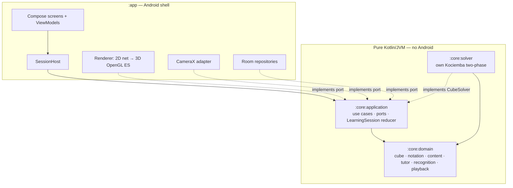
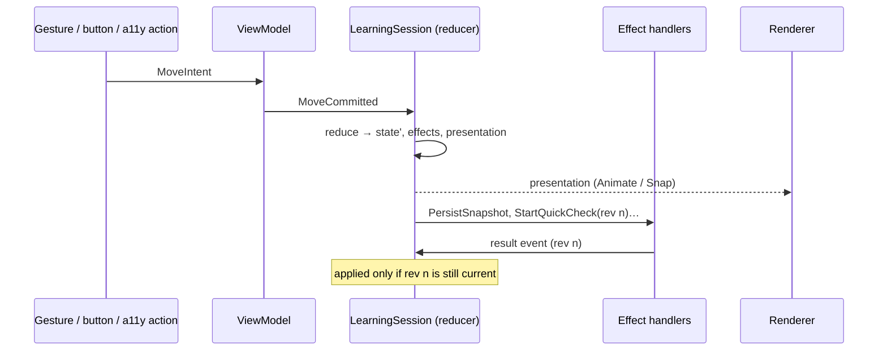
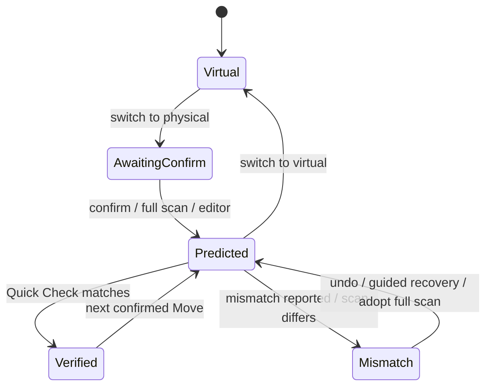
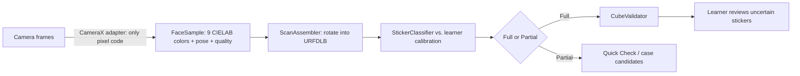
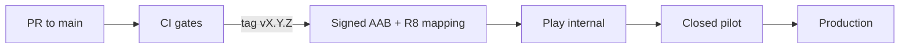

# RubikXplorer — Architecture

> An Android tutor that teaches beginners to solve a 3×3 cube on a virtual or physical cube, and checks their real cube with the camera.
> Kotlin · Jetpack Compose · hexagonal architecture · functional core · own Kociemba solver · on-device recognition · fully offline.

This document explains the architecture for readers: what the system is, how it's shaped, and which decisions keep it correct. The build contract is the terse [architecture spine](../_bmad-output/planning-artifacts/architecture/architecture-RubikXplorer-2026-10-29/ARCHITECTURE-SPINE.md). Each decision is numbered there (`AD-n`), and this document refers to those numbers. The requirements are in the [PRD](../_bmad-output/planning-artifacts/prds/prd-RubikXplorer-2026-10-29/prd.md).

---

## 1. The problem that shapes the architecture

Most cube apps are solvers with a tutorial added. RubikXplorer is a **tutor with a solver inside it**. Its central promise, *never claim what you don't know*, is what drives the architecture:

- **Three cubes, one truth.** The app tracks three cubes:
  - the *virtual* cube on screen;
  - the *expected* cube, which is what the tutor believes is in the Learner's hands;
  - the *physical* cube, which the app only knows when the Learner tells it or the camera sees it.

  Mixing these up is the main correctness risk.
- **Correctness is checkable.** Cube mathematics is deterministic. Moves, validity and solved status can all be proved by property-based tests, so the code that encodes them must be pure and testable without Android.
- **Teaching is content.** Seven Stages, a 2-look mini-Course and 78 OLL/PLL Algorithms change far more often than the engine does.
- **Offline and private by default.** No account, no network permission, no analytics.

## 2. Shape: hexagonal core, Android shell



- **Three of the four Gradle modules are plain Kotlin/JVM.** The compiler, not code review, stops Android, Room or CameraX types from reaching business logic (AD-1).
- **Ports and adapters.** The application layer declares interfaces: `CubeSolver`, `ProgressRepository`, `CalibrationRepository`, `FeatureFlags`, `Clock` and `RandomSource`. The shell implements them. This is the Android version of Clean/Hexagonal Architecture, kept small: four modules, split further only when the boundaries are proven.
- **Functional core, imperative shell.** Cube Moves are pure functions on immutable values. Side effects — touch, animation frames, camera, database, lifecycle — live at the edges.

## 3. The cube model

A cube is stored as **cubies plus orientation** (AD-2):
- the permutation and orientation of the 8 corners and 12 edges;
- one of the 24 ways the whole cube can be held.

| Representation | Used for | Why |
| --- | --- | --- |
| **Cubie model** (canonical) | engine, predicates, Solver | Compact, and it makes legality checks (twist, flip, parity) easy to express. |
| **54 facelets** (I/O only) | renderer, Manual Cube Editor, camera, Solver interop | Close to what people see. Converted to cubies only through `CubeValidator`. |

The design fixes three conventions once, so that no two features can disagree:
- **Home frame:** in the solved home state, white is on U and green is on F.
- **Sticker layout:** sticker indexing follows the Kociemba net.
- **Held orientation is explicit.** Cube Rotations (`x y z`), slice Moves (`M E S`) and wide Moves therefore behave consistently. "You're holding the cube the wrong way" becomes a diagnosable state instead of a silent mismatch.

## 4. One state owner: a reducer, like Redux, in Kotlin

Every session change is an **event** handled by one pure function (AD-3):

```kotlin
fun reduce(state: SessionState, event: SessionEvent): Transition // = new state + effects + presentation
```



- **Commit before animate (AD-4).** A Move is committed to state first, and the animation only catches up. Fast or overlapping input therefore can't leave a half-turned cube. The renderer is a projection with a test hook (`renderedFacelets()`), so "screen equals model" is checked automatically.
  The production 3D adapter lives in `app/render/gl` behind `Cube3DRenderer`; the free cube uses it, while lessons keep the net until Story 5.4. Run its instrumented sync suite with `./gradlew :app:connectedDebugAndroidTest`.
- **Revisioned effects.** Scans, solves and recovery planning are asynchronous. Every effect carries the state revision it was issued at, and results for a stale revision are discarded. This prevents a subtle bug: a Quick Check captured *before* an undo being judged against the state *after* it, which would produce a false "verified".
- **A single owner per thing.** An ownership matrix in the spine gives every entity exactly one writer: cube states, checkpoints, attempts, progress, Algorithm Status, calibration and preferences.

### Physical-cube synchronization



A restored physical session **always** returns to *AwaitingConfirm*. After the app was closed, it can't know what happened to the real cube.

## 5. Honesty, encoded in types

PRD Principle 3, *never claim what you don't know*, is enforced in the types rather than left as a guideline (AD-5):

- `PhysicalObservation` is either `Full(state)`, which must pass validation, or `Partial(faces)`. A partial scan is **never** filled in from the expected state.
- `Certainty` is `VERIFIED | LIKELY | UNKNOWN`. There is no uncalibrated percentage.
- Only one function, `tutor/Assess`, produces Certainty, using one shared candidate enumerator. `VERIFIED` requires two things: the camera saw every face that recent Moves could have changed, and exactly one explanation fits. `Diagnosis.verified(...)` is a smart constructor that can't be called without that evidence.

## 6. Teaching as data

Lessons, Algorithms and tutor thresholds are versioned JSON, checked by JSON Schema (AD-6):

```json
{ "id": "lesson-03-02", "stageId": "stage-03-first-layer-corners",
  "completion": { "predicate": "allOf", "of": [
      { "predicate": "crossSolved", "color": "WHITE" },
      { "predicate": "cornersSolved", "color": "WHITE", "count": 2 } ] },
  "preserve":   { "predicate": "crossSolved", "color": "WHITE" },
  "steps": [ { "goal": "lesson.lesson-03-02.step-1.goal",
               "done": { "predicate": "cornersSolved", "color": "WHITE", "count": 1 }, "preserve": "…", "watch": "…", "notice": "…", "moves": "R U R'" } ] }
```

- **Predicates are a closed, typed Kotlin registry,** not an expression language. They are anchored to colors and work whatever way the cube is held. Each one also reports which pieces must be preserved, which drives diagnosis ("you disturbed the cross") and guided recovery.
- **Step guidance follows the cube, not a script.** Each step carries a `done` predicate, and the current step is always derived from the cube's state. A Learner who reaches a goal another way, or undoes a Move, still sees the right step. *Test me* judges each Move against that step, so the taught opening Move of an insert reads as "on path", never as harmful.
- **Algorithms are verified in the build.** For each of the 78 Algorithms, a test derives its Case from the solved cube and checks that the Algorithm solves it, so a typo fails CI (AD-14). One `LastLayerMatcher` serves the Library, the verification test, 2-look Lessons and camera recognition (AD-19).
- **All text is keyed and localizable** (`Text(key, args)` with ICU arguments), so adding a language needs no code change.

## 7. Solver: own implementation, kept away from teaching

- **Written in-house.** The Solver is a clean-room Kotlin implementation of **Kociemba's two-phase algorithm** (AD-8). The best-known JVM implementation turned out to be GPLv3-only. Writing our own keeps the licence open, and it's a substantial piece of algorithm engineering in its own right.
- **It finds a path; it doesn't teach.** An optimal solution is rarely a good lesson, so only the `SolveCube` and `PlanRecovery` use cases call the Solver. Diagnosis and lesson logic never do.
- **Safe to call.** It runs as an effect with a 3-second timeout, and every solution is re-verified by applying it to the input before it's shown.

## 8. Camera recognition without a cloud



- **Pixel code stays in one adapter.** Only the CameraX adapter touches pixels; everything after it is pure, JVM-testable Kotlin. Recorded `FaceSample` fixtures let recognition accuracy be tested in CI (AD-9).
- **The 6-face scan needs no computer-vision library.** It uses a fixed on-screen grid, so the adapter only reads colors from known positions.
- **Images stay in memory and on the device.** A debug-only tool records samples, never images, for the device × lighting × cube test matrix.

## 9. Privacy, offline and quality are enforced by the build

| Guarantee | Mechanism |
| --- | --- |
| Works offline, collects nothing | No `INTERNET` permission; `allowBackup=false`. CI fails if an analytics, ads or crash SDK appears (AD-13). |
| Correct cube math | Kotest property tests: inverse restores the state, M⁴ = identity, random sequence × inverse = identity, illegal states rejected. |
| Content can't drift | Schema, key and predicate tests, plus verification of all 78 Algorithms. |
| No state drift | A transition-table test suite, checkpoint round-trip tests and renderer-sync tests. |
| Portfolio-grade code | ≥ 80% coverage on pure modules (Kover), Spotless/ktlint and Android lint (including accessibility) on every PR (AD-14). |
| Accessible | One sticker-appearance table, with letters or patterns for color-blind users, used on every surface. Every gesture has a button. The cube has a screen-reader description (AD-17). |
| Safe to cut scope | A `FeatureFlags` port, `OFF / BETA / GA` per build type, implements the PRD's cut order (AD-18). |

## 10. Delivery



- **Branching and signing:** trunk-based development, with Play App Signing and the upload key held in CI secrets.
- **Release builds:** R8 shrinking, and the mapping file uploaded with each release, so Android vitals stack traces are readable. Vitals is the only field signal, by design.
- **Debug builds:** StrictMode and test tooling.

## 11. Stack (verified October 2026)

Kotlin 2.4.21 · AGP 9.5 (built-in Kotlin) · Compose BOM 2026.09.00 · Material3 1.4 · Hilt 2.60 · Room 3.0 · CameraX 1.6.2 · kotlinx.serialization 1.12 · coroutines 1.11 · custom OpenGL ES 3.0 renderer (no 3D library) · Kotest 6.2 · JUnit Jupiter 6 · Kover · Spotless/ktlint · GitHub Actions · minSdk 29, targetSdk 36.

## 12. Open technical questions

| Question | Resolved by |
| --- | --- |
| Quick Scan corner detection (Kotlin / OpenCV / LiteRT) | recognition spike; contained in the camera adapter |
| Performance on the reference devices (Galaxy Tab S7 FE 5G, Galaxy S24 FE) | Story 1.10 benchmark; above 33.3 ms p90 per frame reopens the renderer choice |
| Solver internals (bundled or generated pruning tables) | solver epic, within the 3 s timeout and 30 MB app size |

Gestures are interpreted by the pure `domain/input/GestureInterpreter`; `ViewPose` drives both picking and the GL camera.

View Rotation is renderer-local `ViewOrbit`; a twist is a z Cube Rotation through the free-cube commit.

Lessons draw on `Cube3DRenderer`; arrows are a projected `MoveArrow` overlay, and emphasis uses per-cubie shader flags.
